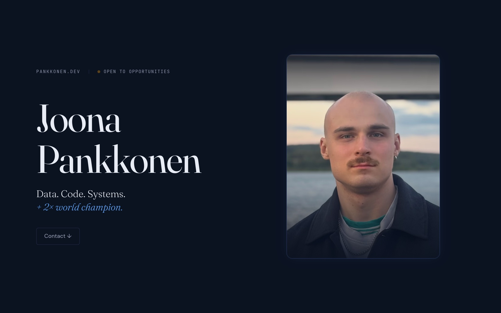
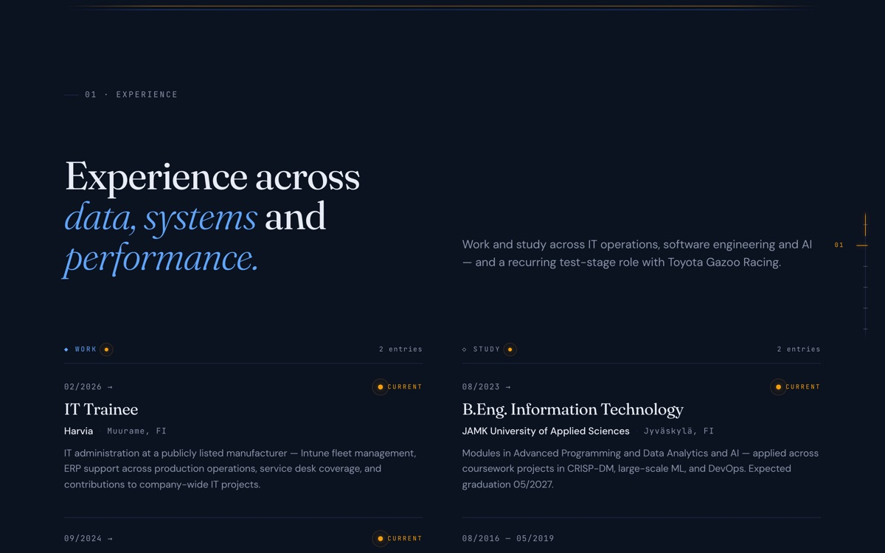
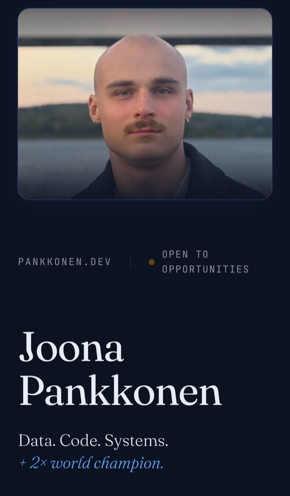
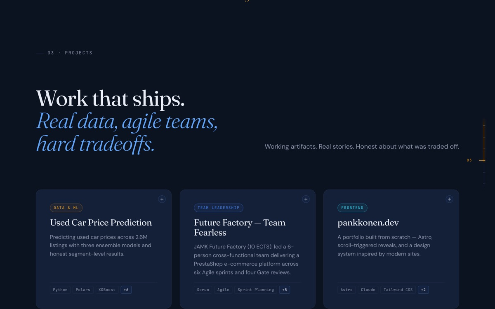
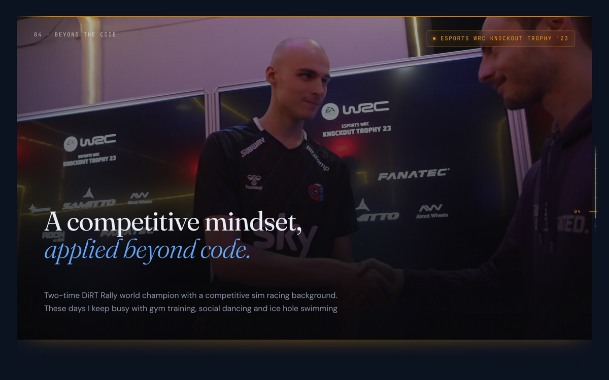
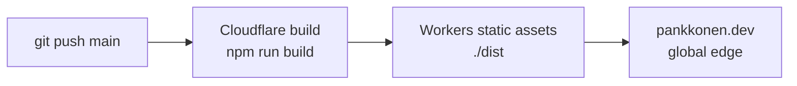

<div align="center">

# pankkonen.dev

**Personal portfolio of Joona Pankkonen, an IT engineering student working on data, AI and systems.**<br/>
Hand-built with Astro: one page, no runtime framework, Lighthouse 100 on desktop.

[](https://pankkonen.dev)
[](https://astro.build)
[](https://tailwindcss.com)
[](https://www.typescriptlang.org)
[](https://workers.cloudflare.com)
[](#performance)

[**Visit the site →**](https://pankkonen.dev)

<br/>



</div>

<br/>

## Contents

- [Overview](#overview)
- [Highlights](#highlights)
- [Screenshots](#screenshots)
- [Tech stack](#tech-stack)
- [Performance](#performance)
- [Design system](#design-system)
- [Accessibility](#accessibility)
- [Architecture](#architecture)
- [Getting started](#getting-started)
- [Deployment](#deployment)
- [How it was built](#how-it-was-built)
- [License](#license)

## Overview

pankkonen.dev is a single-page CV and portfolio. It aims to read like an editorial site rather than a résumé template: deep navy, a serif display face, scroll-triggered motion and one amber accent that is used sparingly.

The page has six chapters:

| # | Chapter | What it shows |
|---|---------|---------------|
| 00 | **Intro** | Name, tagline, availability status and portrait |
| 01 | **Experience** | Two-track timeline with work on one side and studies on the other |
| 02 | **Stack** | Tools in four categories: Data & ML, Infrastructure, AI Workflow, Web |
| 03 | **Projects** | Three case studies. Each one expands into a detail panel with animated stats |
| 04 | **Beyond the Code** | Full-bleed ambient video about competitive sim racing |
| 05 | **Contact** | Email, GitHub and LinkedIn |

## Highlights

- **Ships almost no JavaScript.** Astro renders everything to static HTML at build time. The client-side scripts are small vanilla `IntersectionObserver` handlers, and no animation library or UI framework loads at runtime.
- **Motion built only from CSS keyframes.** The hero has a staggered load-in, sections reveal as they scroll into view, and the five section dividers replay their sweep on every pass in both directions.
- **Chapter rail.** A sticky marker on the right edge tracks the current section and expands into labels on hover.
- **Expandable project cards.** One full-width panel opens below the card grid, and numeric stats count up when the panel appears.
- **Video only when visible.** The *Beyond the Code* clip plays only while it is on screen. Mobile gets a lighter portrait encode, and reduced-motion users see a still poster frame.
- **Fast images.** The hero portrait is served as AVIF (29 KB), with WebP and JPEG fallbacks and a preload hint for LCP.

## Screenshots

<table>
  <tr>
    <td width="72%"></td>
    <td width="28%" rowspan="2" valign="top"></td>
  </tr>
  <tr>
    <td></td>
  </tr>
  <tr>
    <td colspan="2"></td>
  </tr>
</table>

## Tech stack

| Layer | Choice | Why |
|-------|--------|-----|
| Framework | [Astro 6](https://astro.build) | Static output, component model, zero JS by default |
| Styling | [Tailwind CSS 4](https://tailwindcss.com) + scoped component CSS | Utilities for layout, plus hand-written CSS for tokens and motion |
| Language | TypeScript (strict) | Typed content models for projects, stack and experience |
| Motion | CSS keyframes + `IntersectionObserver` | No runtime animation library |
| Fonts | Fraunces · DM Sans · JetBrains Mono | Editorial serif, neutral body text and mono labels |
| Hosting | [Cloudflare Workers](https://developers.cloudflare.com/workers/static-assets/) (static assets) | Global edge CDN and automatic deploys on push |

## Performance

Lighthouse results for the live production site:

| Category | Desktop | Mobile |
|----------|:-------:|:------:|
| Performance | **100** | **98** |
| Accessibility | **100** | **100** |
| Best Practices | **100** | **100** |
| SEO | **100** | **100** |

What gets it there:

- The LCP image is preloaded as AVIF with `fetchpriority="high"`, which saves about 0.4 s of mobile LCP.
- Google Fonts load without blocking render (`media="print"` swap, plus a `<noscript>` fallback).
- The hero entrance uses CSS only, so no script has to run before first paint.
- The background video is gated by `IntersectionObserver` and gets a separate, smaller mobile encode.

> To reproduce: `npm run build && npm run preview`, then run Lighthouse in Chrome DevTools with the tab kept in the foreground.

## Design system

All visual decisions live as CSS custom properties in [`src/styles/global.css`](src/styles/global.css).

| Token | Value | Role |
|-------|-------|------|
| `--bg` | `#0B1220` | Page background |
| `--surface` | `#141F38` | Cards and panels |
| `--text` | `#E8EDF5` | Primary text |
| `--text-muted` | `#8A94A8` | Secondary text and mono labels |
| `--primary-soft` | `#60A5FA` | Italic emphasis in headings |
| `--amber` | `#F59E0B` | The single accent: status dot, active chapter, dividers |
| `--cyan` | `#22D3EE` | Frontend category tint |

**Typography.** Headings are set in Fraunces, body text in DM Sans and labels in JetBrains Mono. Display sizes scale fluidly with `clamp()`.

**Spacing.** An 8 px base scale (`8 · 16 · 24 · 40 · 64 · 104 · 168`).

**Motion.**

- Scroll reveals use a spring curve, `cubic-bezier(0.16, 1, 0.3, 1)`, with a 28 px lift over 750 ms. Hover states and panel transitions use the same curve.
- The hero uses a snappier `cubic-bezier(0.215, 0.61, 0.355, 1)` over 500–700 ms, so the first impression feels immediate.

**Theme.** The site is dark only, by design.

## Accessibility

- Semantic landmarks, a logical heading order and a *Skip to content* link
- Full keyboard navigation with visible focus rings
- `prefers-reduced-motion` support: content appears without transitions and the video shows its poster frame
- Descriptive `alt` text, and `aria-hidden` on purely decorative elements
- Colour contrast checked against WCAG AA

## Architecture

```
src/
├── layouts/
│   └── Layout.astro            # <head>: meta, Open Graph, fonts, preloads
├── pages/
│   └── index.astro             # Page composition, hero, scroll-reveal observer
├── components/
│   ├── ChapterMarker.astro     # Sticky right-rail wayfinder (00–05)
│   ├── Experience.astro        # Two-track work / study timeline
│   ├── Stack.astro             # Four-category tool index
│   ├── Projects.astro          # Case-study cards, expanding panel, stat count-up
│   ├── Beyond.astro            # Full-bleed ambient video section
│   ├── Contact.astro           # Contact links and footer
│   └── *Divider.astro          # Five section transitions
└── styles/
    └── global.css              # Design tokens, base typography, shared motion

public/                         # Static assets: portrait, video, OG image, favicons
docs/design/                    # Design specs and implementation plans per feature
wrangler.toml                   # Cloudflare Workers static-assets config
```

**Content is co-located with its component.** Each section defines its data as a typed array at the top of its `.astro` file, for example `Project[]` in `Projects.astro`. Updating the CV therefore means editing data, not markup.

## Getting started

**Requirements:** Node.js 22 or newer (pinned in [`.node-version`](.node-version))

```sh
git clone https://github.com/joonapankkone/pankkonen-dev.git
cd pankkonen-dev
npm install
npm run dev        # http://localhost:4321
```

| Command | Action |
|---------|--------|
| `npm run dev` | Start the local dev server with hot reload |
| `npm run build` | Build the production site to `./dist` |
| `npm run preview` | Serve the production build locally |

## Deployment



Every push to `main` triggers a Cloudflare build. The `dist/` output is served as static assets from Cloudflare's edge network, as configured in [`wrangler.toml`](wrangler.toml). There is no server code and nothing to keep running.

## How it was built

This site was built with AI pair-programming, and that is a deliberate part of the story. I set the architecture, the design direction and the quality bar. [Claude](https://claude.ai) did much of the implementation under my direction, across Claude Code, Cowork and Design.

Every feature started as a written spec and an implementation plan, which are kept in [`docs/design/`](docs/design). Each plan was reviewed, executed and then refined by hand. The refinement covered animation debugging, responsive edge cases, micro-copy and visual polish.

<details>
<summary><strong>Build log</strong></summary>
<br/>

| Phase | Scope | Shipped |
|-------|-------|---------|
| 1 | Scaffolding: Astro, Tailwind, CSS motion | Apr 2026 |
| 2 | Design system: tokens, fonts, layout primitives | Apr 2026 |
| 3 | Hero: name, tagline, portrait, load stagger | Apr 2026 |
| 4 | Experience timeline and Stack index | Apr 2026 |
| 5 | Project cards and expanding detail panel | Apr 2026 |
| 6 | Beyond the Code: full-bleed video stage | May 2026 |
| 7 | Contact | May 2026 |
| 8 | Polish and accessibility pass (Lighthouse 100/98) | May 2026 |
| 9 | Cloudflare deployment with auto-deploy on push | May 2026 |
| 10 | Custom domain, **v1.0 live** | May 2026 |

</details>

## License

The source code is public so you can see how the site is built, and you are welcome to learn from it.
Personal content is © 2026 Joona Pankkonen, all rights reserved. This covers the text, portrait, video and project write-ups, and none of it may be reused without permission.

<div align="center">
<br/>

**[pankkonen.dev](https://pankkonen.dev)** · [LinkedIn](https://linkedin.com/in/joona-pankkonen-b67463351) · [GitHub](https://github.com/joonapankkone)

</div>
